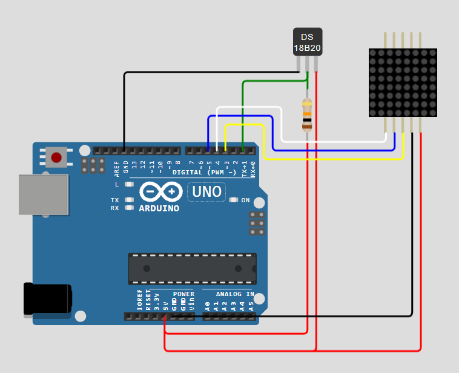

# Arcade Temperatura

Proyecto Arduino que muestra la temperatura ambiente en una matriz de LEDs 8x8 controlada por MAX7219, intercalando la lectura del sensor con animaciones clásicas de videojuegos estilo arcade (Space Invaders, Pac-Man, Tetris, Snake, entre otras).

https://github.com/user-attachments/assets/e7b8d760-5d23-42a5-a099-2689fc7ae8ff

## Características

- **Sensor de temperatura:** DS18B20 (OneWire) conectado al pin digital 2.
- **Display:** Matriz de LEDs 8x8 controlada por el controlador MAX7219 mediante la librería `LedControl`.
- **Lectura de temperatura:** Obtiene el valor en grados Celsius con un decimal de precisión.
- **Visualización numérica:** Muestra los dígitos de decenas y unidades de la temperatura entero usando fuentes de 8x8 pixeles definidas para los dígitos 0-9.
- **Indicador decimal:** Muestra el primer decimal como una barra vertical de LEDs en la última columna de la matriz.
- **Animaciones arcade:** 8 animaciones de frames predefinidas que se reproducen en orden aleatorio entre cada lectura de temperatura.
- **Bucle principal:** Cada ciclo lee la temperatura, reproduce todas las animaciones una vez (en orden mezclado), muestra la temperatura durante 5 segundos por animación, y repite.

---

## Conexiones (Pinout)

| Componente | Pin Arduino | Descripción |
|------------|-------------|-------------|
| DS18B20 (DATA) | Pin 2 | `ONE_WIRE_BUS` |
| MAX7219 DIN | Pin 4 | Data In de la matriz |
| MAX7219 CLK | Pin 5 | Clock de la matriz |
| MAX7219 CS | Pin 6 | Chip Select de la matriz |
| MAX7219 VCC | 5V | Alimentación de la matriz |
| MAX7219 GND | GND | Tierra común |

---

## Librerías utilizadas

- `OneWire.h` — Comunicación 1-Wire con el sensor DS18B20.
- `DallasTemperature.h` — Lectura simplificada de temperatura del DS18B20.
- `LedControl.h` — Control de la matriz 8x8 mediante MAX7219.
- `SPI.h` — Soporte de comunicación SPI (incluido por LedControl).

---

## Animaciones

El proyecto incluye 8 animaciones almacenadas como arreglos de `uint64_t`, donde cada valor representa un frame de 8x8 pixels. Se reproducen en orden aleatorio (mezclado mediante `shuffleIndexes`) antes de mostrar cada lectura de temperatura.

| # | Animación | Frames | Descripción |
|---|-----------|--------|-------------|
| 1 | **Space Invaders** | 24 | Alienígena clásico de Space Invaders con movimiento de apertura/cierre de brazos. |
| 2 | **Pac-Man** | 30 | Personaje Pac-Man con animación de apertura y cierre de boca. |
| 3 | **Tetris** | 32 | Piezas de Tetris cayendo y apilándose. |
| 4 | **Snake** | 26 | Serpiente moviéndose por la pantalla. |
| 5 | **Cuadrado** | 6 | Cuadrado hueco con borde y relleno animado. |
| 6 | **Pin Pong** | 25 | Pelota y paletas estilo Pong moviéndose. |
| 7 | **TNT** | 23 | Bloque de dinamita con mecha encendida y explosión. |
| 8 | **Zigzag** | 29 | Línea diagonal en movimiento continuo (efecto zigzag). |

Cada animación se reproduce a una velocidad de `FRAME_DELAY = 200 ms` por frame.

---

## Formato de visualización de temperatura

La temperatura se muestra en la matriz 8x8 de la siguiente manera:

### Dígitos enteros (decenas y unidades)

La temperatura entera se separa en dos dígitos:

- **Decenas (`tens`):** Se muestra en las filas 0-6 de la matriz usando `lc.setRow`.
- **Unidades (`units`):** Se muestra en las filas 4-10 (offset de +4 filas respecto a las decenas) usando `lc.setRow`.

Cada dígito (0-9) está definido como un arreglo de 8 bytes (`byte[]`) que representa un patrón de 8x8 pixels. La función `displayTemperature` selecciona el patrón correspondiente según el valor del dígito y lo dibuja fila por fila en la matriz.

### Primer decimal

El primer decimal de la temperatura se muestra en la **columna 7** (última columna) de la matriz como indicador vertical de LEDs:

| Valor decimal | Comportamiento en columna 7 |
|---------------|------------------------------|
| 0 | Todos los LEDs apagados |
| 1-8 | LED encendido en la fila `decimal - 1` |
| 9 | Los 8 LEDs de la columna encendidos |

### Flujo del bucle (`loop`)

1. Mezcla el orden de las 8 animaciones (`shuffleIndexes`).
2. Solicita lectura al sensor DS18B20 (`sensors.requestTemperatures`).
3. Obtiene la temperatura en Celsius (`getTempCByIndex`).
4. Extrae decenas, unidades y el primer decimal redondeado.
5. Para cada animación (en orden mezclado):
   - Reproduce la animación completa frame a frame (200 ms por frame).
   - Muestra los dígitos de temperatura en la matriz.
   - Muestra el indicador decimal en la columna 7.
   - Espera 5 segundos antes de pasar a la siguiente animación.

---

## Variables globales

| Variable | Tipo | Descripción |
|----------|------|-------------|
| `tens` | `int` | Dígito de las decenas de la temperatura entera |
| `units` | `int` | Dígito de las unidades de la temperatura entera |
| `tempc` | `float` | Temperatura leída en grados Celsius |
| `animations[]` | `const uint64_t*` | Punteros a las 8 animaciones |
| `animationLengths[]` | `uint16_t` | Cantidad de frames de cada animación |
| `ANIM_COUNT` | `byte` | Número total de animaciones (8) |
| `animOrder[]` | `byte` | Orden de reproducción mezclado de las animaciones |

---

## Funciones principales

| Función | Descripción |
|---------|-------------|
| `setup()` | Inicializa la matriz MAX7219 (desactiva ahorro de energía, brillo bajo, limpia pantalla) y el sensor DS18B20. |
| `shuffleIndexes()` | Mezcla aleatoriamente el orden de índices de animaciones. |
| `drawFrame(uint64_t frame)` | Dibuja un frame de 8x8 en la matriz con rotación de 90° en sentido horario. |
| `playAnimation(byte index)` | Reproduce todos los frames de una animación secuencialmente. |
| `displayTemperature(int tens, int units)` | Dibuja los dos dígitos de la temperatura en la matriz. |
| `displayDecimals(int decimals)` | Muestra el primer decimal como barra vertical en la columna 7. |
| `loop()` | Ciclo principal: lee temperatura, reproduce animaciones y muestra el valor. |

---

## Uso

1. Conecta el DS18B20 al pin 2 y la matriz MAX7219 a los pines 4 (DIN), 5 (CLK) y 6 (CS).
2. Instala las librerías `OneWire`, `DallasTemperature` y `LedControl` desde el Administrador de Librerías de Arduino IDE.
3. Abre `arcade-temperatura.ino` en Arduino IDE.
4. Selecciona tu placa y puerto, luego carga el código.
5. La matriz comenzará a mostrar las animaciones arcade intercaladas con la temperatura ambiente leída por el sensor.
